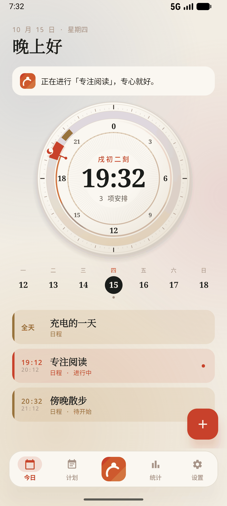
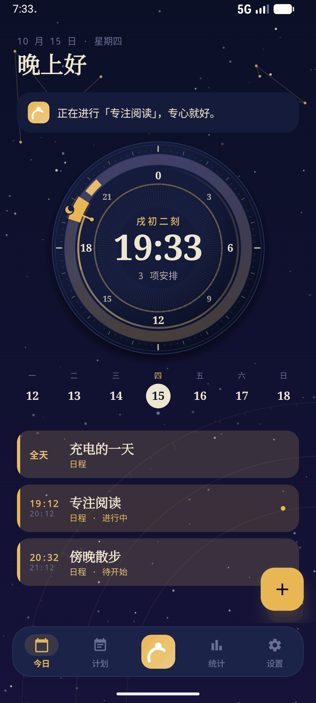
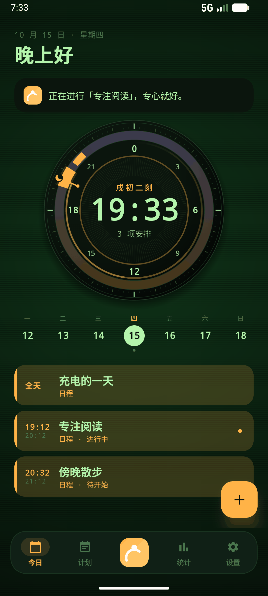
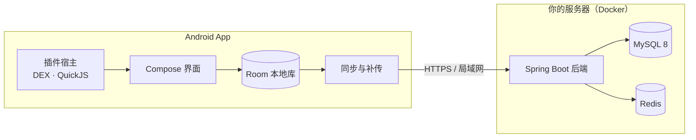

<div align="center">

# 知序 ORIVA

**知你所想，序你所行。**

开源的个人助理：日程与计划在手机上本地优先地运行，数据同步到你自己部署的后端。

[](https://github.com/DzDenzel/zhixu-oriva/releases)
[](LICENSE)


[下载 App](https://github.com/DzDenzel/zhixu-oriva/releases/latest) · [部署后端](deploy/README.md) · [插件开发](android/tools/plugin-sdk/README.md) · [更新记录](https://github.com/DzDenzel/zhixu-oriva/releases)

</div>

<p align="center">
  
  
  
</p>

---

## 简介

知序 ORIVA 由三部分组成：

- **App（Android）**：管理日程、计划与执行记录。所有操作先写入本机，离线可用，联网后自动补传。
- **你自己的后端**：开源的 Spring Boot 服务，用 Docker 一条命令部署在自己的服务器、家用电脑或 NAS 上，供多台设备同步。本项目不运营任何托管服务，数据只存在你的设备和你的服务器上。
- **插件**：DEX 与 JS/TS 两种插件运行时，可以为 App 增加能力和界面。

> *English:* ORIVA is an open-source, local-first personal assistant for Android. Your schedules and plans live on your phone and sync to a backend you host yourself (Docker, one command). No hosted service, no third-party data storage. MIT licensed.

## 功能

**日程与计划**
- 日程、计划、提醒；全天日程与定时安排分开展示
- 日晷式今日视图：一眼看清一天里什么时候做什么
- 执行记录与报告，支持导出 JSON、CSV、ICS

**多设备同步**（v2.1 新增）
- 连接你自己部署的后端，多台设备同步日程与计划
- 两台设备改了同一条内容时，由你选择保留哪个版本，不会悄悄覆盖
- 远端一次删除大量数据时先暂停并请你确认，防止误清空
- 离线修改联网后自动补传，重复提交不会产生重复数据

**界面**
- 六套主题：墨序（随系统明暗）、青瓷、暮霞、构成、星图、荧屏
- 所选主题从冷启动第一屏起保持一致（Android 13 及以上）

**助理与插件**
- 本地助理：理解常见的时间管理指令，任何写入都先给出草稿、确认后才保存
- 插件工坊：支持官方与第三方来源，下载前校验摘要、签名、来源与申请的权限
- DEX 插件承载系统能力；JS/TS 插件运行在 QuickJS 沙箱中，可以向界面贡献内容

## 快速开始

### 1. 安装 App

在 [Releases](https://github.com/DzDenzel/zhixu-oriva/releases/latest) 下载 `zhixu-oriva-<版本>.apk` 并安装。安装前建议按[校验发布文件](#校验发布文件)核对哈希与签名。

已安装 v2.0.0 的用户直接覆盖安装即可，数据和登录状态都会保留，**请勿先卸载**。

只在一台手机上使用的话，可以选择「仅本地使用」，不需要后端。

### 2. 部署后端（可选，多设备同步需要）

需要 Docker 与 Docker Compose 2.24.4 或更新版本。下载源码 ZIP 并解压，在 `deploy` 目录执行：

```sh
# Linux / macOS / NAS
sh install.sh
```

```powershell
# Windows PowerShell
powershell -ExecutionPolicy Bypass -File .\install.ps1
```

脚本会拉取公开镜像 `ghcr.io/dzdenzel/zhixu-oriva-backend`，自动生成数据库、Redis 和 JWT 密钥，再启动 MySQL、Redis 与后端。数据库和 Redis 不对外开放端口；重复运行不会覆盖已有数据。

### 3. 连接

1. 打开终端显示的初始化页，设置所有者账号，并确认手机能访问的地址。
2. 初始化页会生成连接二维码。在 App 的「设置 → 后端连接」导入二维码图片或粘贴连接配置。
3. 用所有者账号登录。其他设备导入同一份配置，登录同一账号，即可开始同步。

公网 HTTPS、升级、备份恢复和网络排障见 [部署说明](deploy/README.md)。

## 架构



App 的所有写入先落到本机 Room 数据库，界面只读本机数据；同步层在后台与后端交换完整快照，冲突与批量删除交给用户确认。后端数据库结构由 Flyway 管理，升级镜像时自动迁移。

## 项目结构

| 目录 | 内容 |
|---|---|
| `android/app` | 应用入口、导航、主题与启动 |
| `android/core-*` | 接口、本地库、同步、执行引擎、免打扰、安全、设计组件、插件宿主 |
| `android/feature-*` | 今日 / 计划、统计、设置、引导等界面 |
| `android/tools/plugin-sdk` | JS/TS 插件 SDK、模板、打包与校验工具 |
| `backend/planlock-*` | Java 21 / Spring Boot / MyBatis：账户、计划、日程、策略、记录、同步 |
| `backend/plugins` | 插件目录与已签名示例包 |
| `deploy` | Docker 镜像、Compose 编排、安装 / 备份 / 恢复脚本、可选 HTTPS（Caddy） |

## 从源码构建

<details>
<summary><b>Android</b></summary>

需要 JDK 21、Android SDK 36（Build Tools 36.0.0）、NDK 27.0.12077973、CMake 3.22.1。Gradle 版本由仓库自带的 wrapper 固定。

```sh
cd android
./gradlew testDebugUnitTest lintDebug assembleDebug
```

- debug 构建默认使用本地模拟数据接口；连接真实后端时加 `-PPLANLOCK_USE_MOCK=false`。
- release 构建始终使用真实接口，输出未签名 APK：`./gradlew :app:assembleRelease -PPLANLOCK_USE_MOCK=false`，再用 `zipalign` 和 `apksigner` 以你自己的密钥签名。自行签名的 APK 证书与官方版本不同，不能覆盖安装官方版本。
- 最低支持 Android 7.0（API 24）。

</details>

<details>
<summary><b>后端（不使用 Docker）</b></summary>

需要 JDK 21、Maven 3.9+、MySQL 8 与 Redis。先创建 UTF-8 数据库 `planlock`，并通过环境变量提供凭据：

| 环境变量 | 说明 |
|---|---|
| `PLANLOCK_DB_USER` / `PLANLOCK_DB_PASSWORD` | MySQL 用户与口令（口令必填） |
| `PLANLOCK_REDIS_HOST` / `PLANLOCK_REDIS_PORT` / `PLANLOCK_REDIS_PASSWORD` | Redis 连接，默认 `localhost:6379` |
| `PLANLOCK_JWT_SECRET` | 至少 32 字节的随机密钥（必填） |
| `PLANLOCK_PLUGIN_DIRECTORY` | 插件目录，默认为启动目录下的 `plugins` |
| `SPRING_DATASOURCE_URL` | 需要时覆盖默认连接串 `localhost:3306/planlock` |

```sh
cd backend
mvn clean verify
java -jar planlock-app/target/planlock-app-2.1.0.jar
```

默认监听 8080 端口。Flyway 会在空库上自动建表；已有数据库接入前请先备份并核对迁移历史，不要对存量库直接导入建表脚本。

</details>

<details>
<summary><b>插件 SDK</b></summary>

需要 Node.js 22+：

```sh
cd android/tools/plugin-sdk
npm ci
npm run verify
```

包格式、签名与发布见 [SDK 说明](android/tools/plugin-sdk/README.md)，服务端插件目录见 [插件目录说明](backend/plugins/README.md)。官方与第三方来源的签名私钥不随源码提供；自建来源须配置自己的签名与信任关系。

</details>

## 安全与隐私

- **数据归属**：本项目不运营托管服务；你的日程、计划与执行记录只存储在你的设备和你部署的后端上。
- **App 访问的外部服务**：除你配置的后端与插件目录外，天气功能会向 [Open-Meteo](https://open-meteo.com/) 发送你搜索的城市名（`geocoding-api.open-meteo.com`）或所选城市的经纬度与时区（`api.open-meteo.com`），用于查询城市与当前天气。地点搜索与反查优先使用 Android 系统 Geocoder（服务提供方由设备决定），发送查询地名或选点坐标；地名搜索不可用时使用 Open-Meteo 城市搜索。地图默认向 [OpenStreetMap](https://www.openstreetmap.org/copyright) 瓦片服务（`tile.openstreetmap.org`）发送当前视野的缩放级别和瓦片编号，以加载底图；服务方也可见网络地址和应用 User-Agent。这些查询不携带知序账号凭据、日程标题或日程备注。系统定位需要定位授权；手动天气地点保持有效，直到选择使用当前位置。
- **地图配置与署名**：`MapTileSettings` 可配置 HTTPS XYZ 瓦片地址与对应署名，坐标使用 WGS84；默认服务遵守 [OpenStreetMap 瓦片使用政策](https://operations.osmfoundation.org/policies/tiles/)，保留可见署名，使用独立应用 User-Agent、至少七天缓存，不提供区域预取或离线下载。地图组件为 [osmdroid 6.1.20](https://github.com/osmdroid/osmdroid)（Apache-2.0）；仓库已归档，升级或替换风险见真机能力实现记录。
- **传输**：公网地址强制 HTTPS。局域网 HTTP 仅对连接配置中显式允许、且解析结果全部为私网地址的端点生效，不放宽系统全局的明文传输策略。
- **部署默认值**：密钥在安装时随机生成且仅当前用户可读；数据库与 Redis 不暴露端口；部署模式关闭公开注册与验证码登录。
- **连接配置**：二维码与连接 JSON 只包含公开字段（实例名称、地址等），不含密码或令牌。
- **插件**：安装前校验摘要、签名与来源；插件申请的能力须用户授权。

发现安全问题请通过 GitHub 私密漏洞报告（Security → Report a vulnerability）联系，不要直接公开 Issue。

## 校验发布文件

每个 Release 附带 `SHA256SUMS` 和公开签名证书 `oriva-release.cer`。

```sh
sha256sum -c SHA256SUMS
apksigner verify --print-certs zhixu-oriva-2.1.0.apk
```

Windows 可用 `Get-FileHash .\zhixu-oriva-2.1.0.apk -Algorithm SHA256`。将 `Signer #1 certificate SHA-256 digest` 与 Release 说明中公布的证书指纹比对，一致即为官方构建。

## 已知限制

- 公网 HTTPS 自动证书尚未使用真实域名验证。
- 后端镜像目前只验证了 linux/amd64；arm64 与具体 NAS 型号尚未验证。
- AI 对话模式尚未开放，当前为本地指令助理；附件目前只有选择入口，暂不支持读取和总结。
- 统计页暂不包含尚未上传到后端的本机执行记录。
- Android 12L 及以下，冷启动时的系统启动窗口不跟随所选主题（应用内主题不受影响）。

## 路线图

| 版本 | 内容 |
|---|---|
| **v2.1**（当前） | 自建后端部署套件、多设备同步与冲突确认、六套主题 |
| v2.2 | 云平台一键部署（优先免费层，收费项事先说明） |
| v2.3 | App 内部署向导 |
| 之后 | 日常记录、iOS、Web 端、开源插件站 |
| v3.0 | AI 内核：在你自己的后端上理解你的习惯，生成可迁移的个人档案（暂缓） |

## 参与贡献

欢迎提交 Issue 与 Pull Request。提交代码前请确保 Android 单测与 lint、后端 `mvn clean verify` 通过；涉及界面的改动请附截图。

## 许可证

项目代码以 [MIT License](LICENSE) 开源。第三方组件保留各自许可：嵌入的 QuickJS 为 MIT；理念词字体 Ma Shan Zheng 子集遵循 SIL Open Font License 1.1（见 `android/app/src/main/assets/licenses/zhixu_motto_OFL.txt`）；其余依赖遵循各自的许可证。
